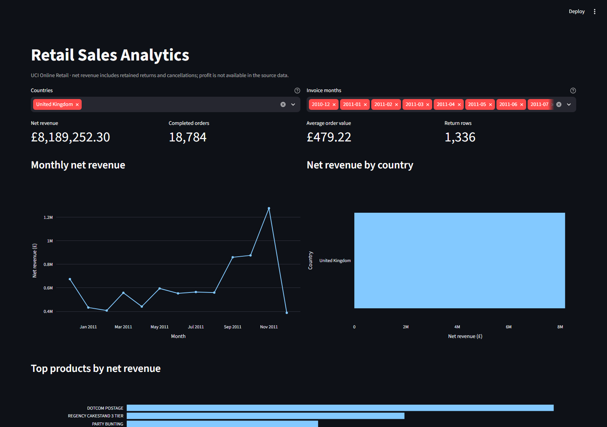
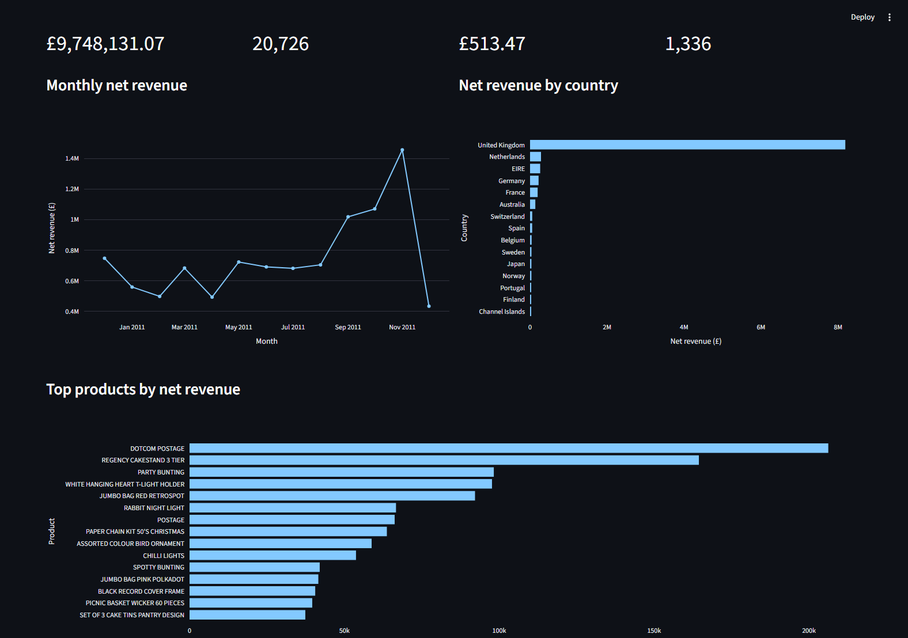
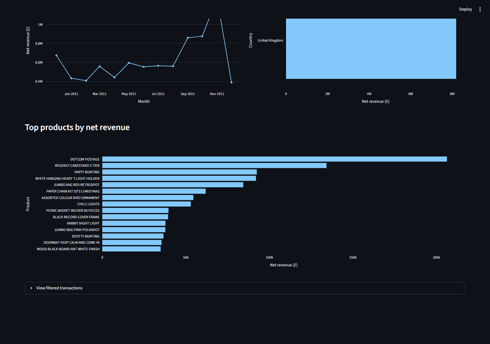
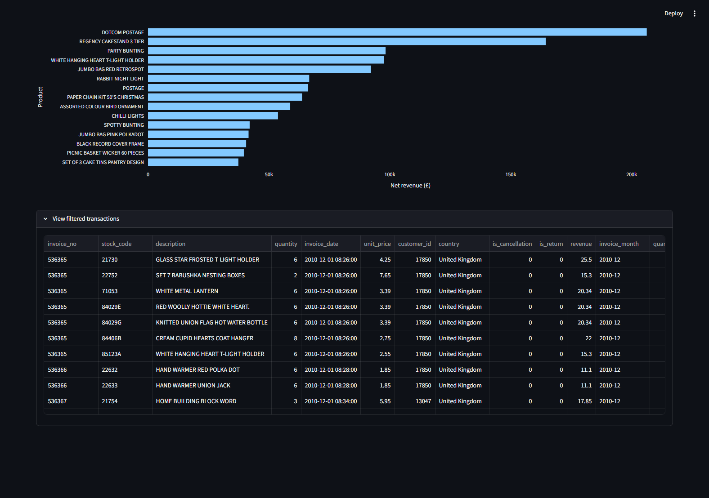
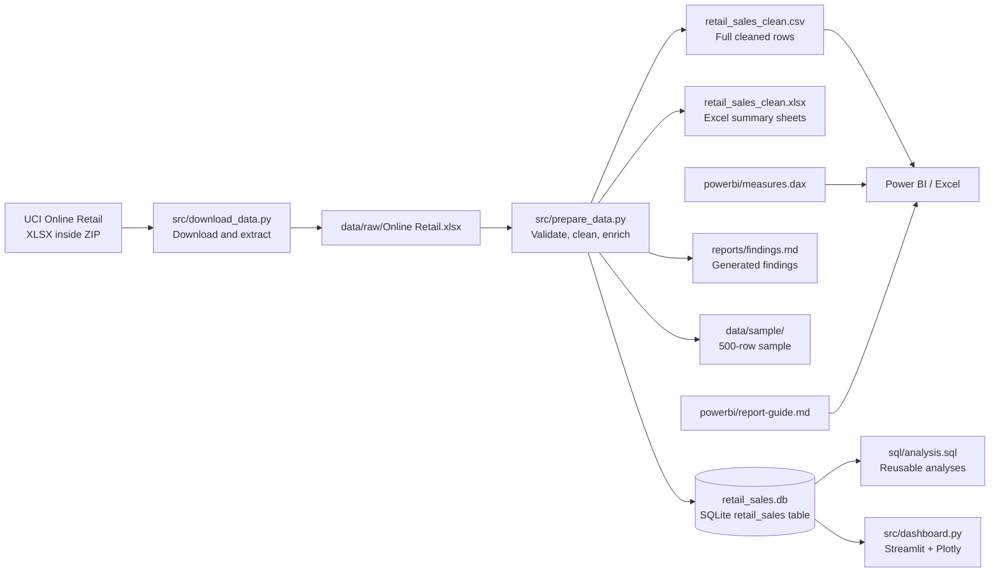

# Retail Sales Analytics & KPI Dashboard

> A reproducible retail analytics project: clean real transaction data, analyze
> it with SQL, explore the results in an interactive dashboard, and turn
> evidence into responsible business recommendations.


## Project at a glance

This project explores transaction records from a UK-based online retailer. It
answers practical questions such as:

- How does transaction revenue change from month to month?
- Which countries and products contribute the most recorded revenue?
- How many completed orders were recorded, and what is their average order
  value?
- How many transaction rows are marked as returns or cancellations?
- Which data-quality issues should an analyst disclose before making a
  recommendation?

The deliverable is an end-to-end analytics portfolio/capstone project—not just
a screenshot or static chart. The source data is downloaded from UCI, cleaned
with documented rules, stored as CSV/Excel/SQLite outputs, queried with SQL,
visualized in Streamlit, and summarized in a generated findings report.

> **Important:** this dataset does not contain cost, profit, product-category,
> inventory, or return-reason fields. The dashboard reports **revenue, not
> profit**. It analyzes countries and individual products; it does not invent
> categories or regional breakdowns that the source cannot support.

## Dashboard screenshots

The images below are captured from the running dashboard using the cleaned UCI
data. They are stored in the repository so they can be viewed on GitHub without
running the app.

### 1. KPI overview and interactive filters



The country and invoice-month selectors filter the KPI cards and charts.
Initially, the dashboard selects the United Kingdom and all available months.
Clear a selector to include all values for that filter.

### 2. Revenue trends and country comparison



Use the line chart to compare monthly net revenue and the horizontal bars to
compare the leading countries in the current filter selection.

### 3. Top products and transaction details



The product chart ranks products by net revenue. Expand **View filtered
transactions** in the live app to inspect the rows behind the summary.

### 4. Filtered transaction table



The table shows the filtered transaction rows and derived flags used in the KPI
calculations. It is useful for spot-checking individual records and
understanding the measures behind the aggregate charts.

> Screenshots reflect this historical dataset, not live retail data. Values
> change when the filters change.

## Dataset and attribution

- **Dataset:** [Online Retail](https://archive.ics.uci.edu/dataset/352/online+retail)
- **Repository:** UCI Machine Learning Repository
- **Citation:** Chen, D. (2015). *Online Retail* [Dataset]. UCI Machine Learning
  Repository. <https://doi.org/10.24432/C5BW33>
- **License:** [CC BY 4.0](https://creativecommons.org/licenses/by/4.0/)
- **Original coverage:** 1 December 2010 – 9 December 2011
- **Original records:** 541,909 transaction rows

The records include invoice number, stock code, product description, quantity,
invoice date, unit price, customer ID, and country. Customer IDs are missing on
some rows. The data is historical and represents one retailer, not the entire
retail industry.

When you redistribute the dataset or derived extracts, retain attribution to
the UCI source and comply with CC BY 4.0.

## What the analysis reports

| Measure | Definition in this project |
|---|---|
| **Net revenue** | Sum of `quantity × unit_price` over retained rows. Negative-quantity rows reduce the sum; cancellation invoices are retained in the main revenue total. |
| **Completed orders** | Distinct invoices not marked as cancellation that contain at least one positive-quantity row. |
| **Average order value (AOV)** | Revenue on non-cancellation invoices (including their return adjustments) divided by completed orders. Returns are not separately linked to an original order, so this is descriptive, not cohort-adjusted. |
| **Return rows** | Negative-quantity rows not marked as cancellation. The source does not contain a return-reason field. |
| **Cancellation rows** | Rows whose invoice number starts with `C`. They remain in net revenue and are excluded from completed-order counts. |
| **Outlier flag** | Positive-quantity rows with quantity or unit price outside the 1.5 × IQR bounds. These are flagged for review, not deleted automatically. |
| **Monthly growth** | Percentage change in total retained-row revenue from the prior calendar month, calculated by the SQL query. |

The interactive Streamlit page currently shows four KPI cards (net revenue,
completed orders, AOV, and return-row count), a monthly line chart, a country
bar chart, a top-products bar chart, and an expandable transaction table.
Product rankings use stock code and description; descriptions are **not** a
validated product-category taxonomy.

### Example results from this dataset

These figures are generated from the cleaned transaction data in this
workspace. They are descriptive results, not forecasts or causal findings.

- **Cleaned rows:** 536,639 (from 541,909 source rows)
- **Net revenue:** £9,748,131.07
- **Completed orders:** 20,726
- **Average order value:** £513.47
- **Largest country by net revenue:** United Kingdom, £8,189,252.30 (84.0%)
- **Highest-revenue month:** November 2011, £1,456,145.80
- **Top product by net revenue:** DOTCOM POSTAGE (stock code `DOT`),
  £206,245.48
- **Return rows retained:** 1,336
- **Cancellation rows retained:** 9,251

The £0.00 recorded against negative-quantity rows in this dataset is not
evidence that returns have no financial impact: those rows have zero unit price
in the source. Investigate return adjustments with a system containing the
original transaction and refund amounts before using them for decisions.

## Architecture



### How the project works

1. **Download:** `src/download_data.py` fetches the public UCI ZIP archive and
   extracts the Excel workbook to `data/raw/`.
2. **Validate and clean:** `src/prepare_data.py` checks required source
   columns, converts dates and numeric fields, removes exact duplicates,
   applies transparent validity rules, and adds analytical fields.
3. **Create outputs:** the preparation step writes a full CSV, a compact Excel
   workbook of summaries, a SQLite database, a fixed-seed 500-row sample, a
   data-quality summary, and a findings report.
4. **Analyze:** the SQL script queries the SQLite table for month-over-month
   revenue, order/AOV measures, country and product rankings, and returns /
   cancellation activity.
5. **Explore:** the Streamlit app reads SQLite, applies the selected country
   and month filters, calculates KPIs, draws Plotly charts, and provides an
   expandable table of the filtered rows.
6. **Present:** use the cleaned CSV with Excel or Power BI. DAX measures and
   report-building guidance are in `powerbi/`.

## Data cleaning and quality decisions

Cleaning is deterministic and implemented in `src/prepare_data.py`.

1. **Required fields:** fail with an explicit message if expected source
   columns are missing.
2. **Text normalization:** trim invoice, stock-code, description, and country
   values; convert blank descriptions to `Unknown`.
3. **Numeric/date parsing:** parse invoice dates and quantities/prices;
   unparseable values become invalid rows. Customer IDs are parsed as nullable
   integers.
4. **Duplicates:** remove exact duplicate rows and count how many were removed.
5. **Invalid transactions:** remove rows missing an invoice, stock code, valid
   date, country, quantity, or unit price; also remove zero-quantity rows and
   negative unit prices.
6. **Missing customer IDs:** retain these rows because the transaction may
   still be analytically useful.
7. **Returns and cancellations:** retain negative quantities and cancellation
   invoices. A cancellation is identified by an invoice number beginning with
   `C`; a return row is negative quantity without that cancellation marker.
8. **Revenue:** calculate `quantity × unit_price` for each row. Do not interpret
   this as profit or as a verified refund amount.
9. **Outliers:** calculate 1.5 × IQR bounds from positive-quantity rows and
   flag out-of-bound quantity/unit-price values. Do not silently remove them.
10. **Reproducibility:** use a fixed random seed (`42`) to generate the
    500-row sample.

Current quality counts are written to `reports/data_quality.json` and the
Excel workbook's **Data Quality** sheet:

| Quality check | Result |
|---|---:|
| Original source rows | 541,909 |
| Exact duplicates removed | 5,268 |
| Invalid rows removed | 2 |
| Clean rows retained | 536,639 |
| Missing customer IDs retained | 135,035 |
| Return rows retained | 1,336 |
| Cancellation rows retained | 9,251 |
| Outlier rows flagged, not removed | 64,871 |

Counts are observations from this dataset and will be regenerated from the
downloaded source; they should not be hard-coded as universal expectations.

## Repository contents

```text
.
├── data/
│   ├── raw/                     # Downloaded source workbook (not committed)
│   ├── processed/               # Full CSV, Excel, SQLite (not committed)
│   └── sample/                  # Reproducible 500-row cleaned CSV sample
├── docs/
│   └── screenshots/             # Captured dashboard views used in this README
├── powerbi/
│   ├── measures.dax              # DAX measure definitions
│   └── report-guide.md           # Power BI load and visual guide
├── reports/
│   ├── findings.md               # Generated from cleaned data
│   └── data_quality.json         # Generated cleaning counts
├── sql/
│   └── analysis.sql              # Reusable SQLite analysis queries
├── src/
│   ├── dashboard.py              # Streamlit dashboard
│   ├── download_data.py           # UCI download/extraction
│   └── prepare_data.py            # Cleaning and output generation
├── tests/
│   └── test_prepare_data.py       # Data-cleaning tests
├── requirements.txt
└── README.md
```

The raw workbook and large processed exports are excluded from Git by
`.gitignore`. The scripts can recreate them. A small cleaned sample is kept in
the repository as a convenient preview.

## Run locally

### Requirements

- Windows 10/11, macOS, or Linux
- Python 3.11 or later
- Internet access for the initial UCI download

### Windows PowerShell

From the project root:

```powershell
py -3.11 -m venv .venv
.\.venv\Scripts\Activate.ps1
python -m pip install --upgrade pip
python -m pip install -r requirements.txt
python src\download_data.py
python src\prepare_data.py
streamlit run src\dashboard.py
```

Streamlit prints the local address (normally `http://localhost:8501`). Open
that address in a browser. Keep the terminal running while using the dashboard.

## Hosting compatibility

This repository is suitable for GitHub as source code, but the current dashboard
is **not a Vercel deployment**. The app is started with `streamlit run` and uses
Streamlit's own long-running server/session model. Vercel's Python runtime
deploys supported applications as request-driven Functions; its WebSocket
support does not turn a Streamlit app into a Vercel Function. No Vercel
configuration is included, to avoid suggesting a deployment that will not run
this project as-is.

The full SQLite database, original workbook, and full cleaned export are also
excluded from Git because of their size. A hosted Streamlit deployment therefore
needs an explicit way to provision or generate the database in the host
environment. The local setup below is verified; a public cloud deployment is
not claimed as tested or ready by merely connecting this repository.

If PowerShell blocks environment activation, run the scripts using
`.venv\Scripts\python.exe` directly, for example:

```powershell
.\.venv\Scripts\python.exe -m pip install -r requirements.txt
.\.venv\Scripts\python.exe src\download_data.py
.\.venv\Scripts\python.exe src\prepare_data.py
.\.venv\Scripts\streamlit.exe run src\dashboard.py
```

### macOS / Linux

```bash
python3 -m venv .venv
source .venv/bin/activate
python -m pip install --upgrade pip
python -m pip install -r requirements.txt
python src/download_data.py
python src/prepare_data.py
streamlit run src/dashboard.py
```

### Generated files

| Path | Contents | Typical use |
|---|---|---|
| `data/raw/Online Retail.xlsx` | Original UCI workbook | Source of truth for rebuilding |
| `data/processed/retail_sales_clean.csv` | All cleaned transaction rows and derived fields | Power BI, Excel, further analysis |
| `data/processed/retail_sales_clean.xlsx` | Monthly, country, top-product summaries and data-quality sheet | Quick Excel review |
| `data/processed/retail_sales.db` | SQLite `retail_sales` table and indexes | SQL and dashboard |
| `data/sample/retail_sales_sample.csv` | 500 reproducible cleaned rows | Preview/schema example |
| `reports/findings.md` | Generated data findings and limitations | Results/report starting point |
| `reports/data_quality.json` | Cleaning counts | Audit and reproducibility |

The Excel workbook is intentionally a summary workbook, not the full 536k-row
transaction export. Use the cleaned CSV when you need the complete table.

## Run the SQL analysis

With the SQLite command-line utility installed:

```powershell
sqlite3 data\processed\retail_sales.db ".read sql\analysis.sql"
```

The SQL file contains five runnable queries:

1. Monthly net revenue and month-over-month percentage change (`LAG` window
   function).
2. Completed-order count, completed-order revenue, and average order value.
3. Net revenue and completed orders by country.
4. Top 20 products by net revenue and net quantity.
5. Return-row count, cancellation-row count, and recorded return-row revenue.

Alternatively, open the SQLite database in a database viewer and run each
statement from `sql/analysis.sql`.

## Build an Excel analysis

1. Run the preparation script.
2. Open `data/processed/retail_sales_clean.xlsx` to see the generated summary
   tabs: **Monthly**, **Countries**, **Top Products**, and **Data Quality**.
3. To create your own PivotTables from all rows, open Excel and choose
   **Data → Get Data → From Text/CSV**.
4. Select `data/processed/retail_sales_clean.csv`, check the date and numeric
   column types, and load it to a worksheet or the Data Model.
5. Build PivotTables by month, country, or product. Use `revenue` for
   transaction revenue and clearly state whether cancellations/returns are
   included.

## Build a Power BI report

1. Generate the cleaned CSV with the steps above.
2. In Power BI Desktop, choose **Get data → Text/CSV** and load
   `data/processed/retail_sales_clean.csv`.
3. Check the types: `invoice_date` as Date/Time, `invoice_month` as text,
   quantity/unit price/revenue as numeric, and `is_*` / `*_outlier` fields as
   Boolean.
4. Add the measures from [`powerbi/measures.dax`](powerbi/measures.dax).
5. Apply currency formatting to revenue/AOV measures.
6. Follow [`powerbi/report-guide.md`](powerbi/report-guide.md) for suggested
   overview, product/country, and returns/data-quality pages.

The Streamlit app and Power BI model are separate presentation options; Power
BI is not required to run the local web dashboard.

## Tests

Run the focused data-cleaning tests:

```powershell
python -m pytest -q
```

The tests check duplicate removal, retention of missing customer IDs, return /
cancellation handling, revenue calculation, and clear errors for missing
source columns.

## Business interpretation and limitations

- The top country and product identify where recorded revenue is concentrated;
  they do not establish why it is concentrated or whether it is profitable.
- The source covers roughly one year and December 2011 is partial. A single
  year is not enough to prove recurring seasonality or build a robust forecast.
- Returns are not linked to a separate original invoice/refund amount in a way
  this project can verify. Negative-quantity rows have zero recorded unit
  prices in this dataset.
- Cancellation records are kept in the main revenue totals to preserve a
  transparent transaction-level calculation. For alternative business
  definitions, filter them out explicitly and state that definition.
- Outliers may be bulk orders or valid business events. Flags are prompts for
  review, not automatic evidence of error.
- Customer ID is missing on some rows; customer-level metrics would cover only
  the identifiable subset and should disclose that limitation.
- There are no cost, profit, inventory, marketing, customer-demographic,
  product-category, or return-reason fields. Profit margin, category strategy,
  causal effects, and inventory optimization cannot be inferred.
- The data is historical, from one online retailer, and must not be represented
  as current market-wide retail performance.

Treat findings as a starting point for investigation, not as unsupported
business guarantees.

## Reproducibility checklist

- [ ] Cite the UCI dataset and retain its CC BY 4.0 attribution.
- [ ] Run download and preparation scripts before opening the dashboard.
- [ ] Review generated quality counts and cleaning decisions.
- [ ] State the revenue / cancellation / return definition in presentations.
- [ ] Do not label revenue as profit or infer missing fields.
- [ ] Re-run `python -m pytest -q` after changing cleaning code.
- [ ] Regenerate reports and screenshots if dashboard behavior or design changes.
